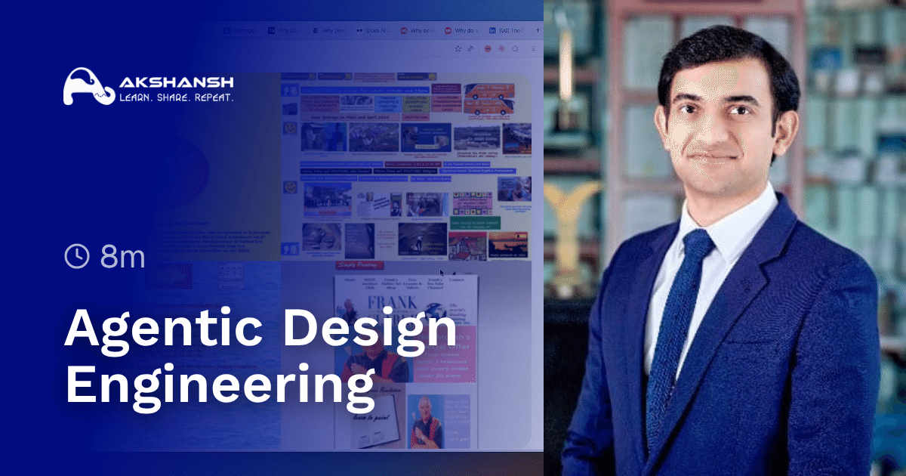
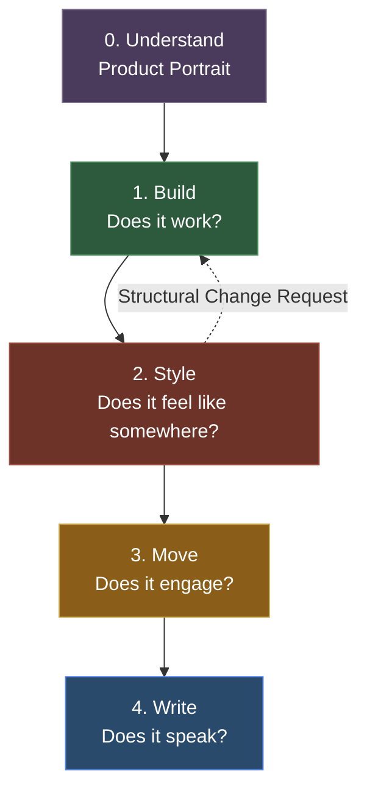
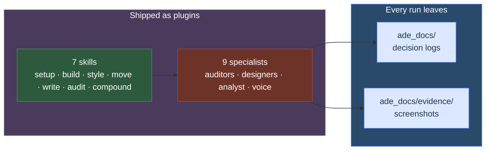
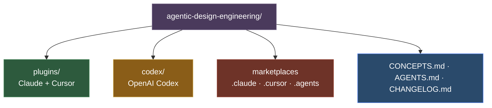
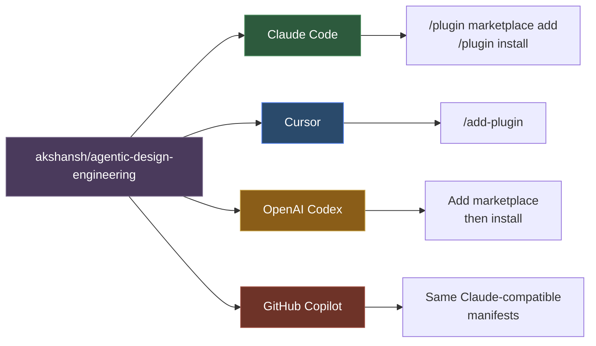

# Agentic Design Engineering

**Transform generic UIs into intentional, inhabited digital places.**

Works with **Claude Code**, **Cursor**, **OpenAI Codex**, and **GitHub Copilot** · Current release: **v3.3** (manifest `0.3.3`) · [Changelog](CHANGELOG.md)

---

## What it is

Agentic Design Engineering (ADE) is a design methodology, shipped as plugins for AI coding agents, that turns default-looking interfaces into spaces that feel crafted, inhabited, and distinctly human.

Four frameworks — **Build**, **Style**, **Move**, **Write** — plus readiness, audit, and compound skills. Not a component library. A design philosophy with teeth: scored gates, repair loops, decision logs, and screenshot evidence.

This README serves two readers equally: a human developer arriving fresh, and an AI agent that needs accurate context before touching the code. Shared vocabulary lives in [`CONCEPTS.md`](CONCEPTS.md). Authoring rules for this repo live in [`AGENTS.md`](AGENTS.md).

---

## Why it exists

Most AI-built interfaces look the same. Rounded corners, neutral grays, tidy rows of cards. Competent, functional, forgettable. The internet is becoming an office park — every app a different floor of the same building.

ADE exists to change that. Theme is not a costume of labels on a hamburger menu. Craft lives in small details — materials, light, physics, acoustic signature, a hidden fingerprint. Software should feel like a place you want to stay, not a form you endure.

---

## Watch the Walkthrough

[](https://supercut.ai/share/akshansh/C1YmDLwspBPB14BJSHnAMI)

*8 min · The origin story, the four frameworks, and a live install demo.*

---

## How it works

Every run starts with **Step 0 — Understand**: the agent builds a Product Portrait (domain, persona, emotional weight, physical analog, sound appropriateness, declared concept) before changing anything. Then the four frameworks run in fixed order. Each gates the next at **40/50**. A full audit reports **/200**. The only sanctioned back-edge is Style's Structural Change Request to Build — when a metaphor cannot inhabit the current information architecture, structure changes first. Reskins are not transformations.



### Build — Structure & Accessibility

*"Before anything else, the interface must be usable."*

Audits and repairs five dimensions: **C**opy, **L**ayout, **E**mphasis, **A**ccessibility, **R**eward. Accessibility issues are fixed first, always. Context-branched for eight product types.

### Style — Atmosphere & Art Direction

*"Every application inhabits a place. Your job is to discover which place, then build it."*

Physical metaphors with real materials, light, temperature, and acoustic signature. Selects the rendering stack the metaphor demands (layered CSS, P5.js, Three.js, SVG+GSAP, WebGL shaders). Enforces the **Metaphor Fidelity Ladder**: target level ≥ 3 (behavioral inhabitation). Levels 0–1 are costumes and cap the metaphor score.

### Move — Interactivity & Game Design Thinking

*"You can take almost anything, and looking at it the right way, make it a fascinating interactive experience." — Will Wright*

Micro-interactions, physics matched to the metaphor, discovery layers, an opt-in sound layer of material-derived earcons, and a **required easter egg** — the creator's hidden signature.

### Write — Intentional Communication

*"Simplification is kindness. Every unnecessary word is a tiny cruelty."*

Rewrites UI copy for warm partnership, purpose before action, compassionate errors, and metaphor language. Supports custom voice profiles. Scope: UI copy only.

### Concept map



---

## What's inside

The same methodology ships twice — Claude Code + Cursor (skills + dedicated agents) and OpenAI Codex (skills only; agents become specialist skills). Keep them in parity when editing. Three marketplace manifests let hosts install directly from GitHub.

```
agentic-design-engineering/
│
├── plugins/agentic-design-engineering/   # Claude Code + Cursor package
│   ├── agents/                           # 9 dedicated agents
│   │   ├── analysis/                     # codebase-comprehender
│   │   ├── review/                       # build · style · move · write auditors
│   │   ├── design/                       # metaphor-discoverer · atmosphere-builder · vitality-injector
│   │   └── voice/                        # voice-writer (file: akshansh-voice.md)
│   ├── skills/
│   │   ├── ade-setup/                    # readiness check (read-only)
│   │   ├── ade-build|style|move|write/   # frameworks + references/
│   │   ├── ade-audit/ · ade-compound/    # score / full pipeline
│   │   └── shared/                       # Step 0, handoffs, sound, evidence trail
│   ├── rules/ade-conventions.mdc         # Cursor: order + gates
│   └── docs/                             # decision-log template
│
├── codex/agentic-design-engineering/     # OpenAI Codex package (mirror)
│   └── skills/                           # framework skills + 9 specialist skills
│
├── .claude-plugin/marketplace.json       # Claude (+ Copilot) marketplace
├── .cursor-plugin/marketplace.json       # Cursor marketplace
├── .agents/plugins/marketplace.json      # Codex marketplace (ade-marketplace)
├── AGENTS.md                             # authoring instructions for this repo
├── CLAUDE.md · GEMINI.md                 # host entry points → AGENTS.md
├── CONCEPTS.md                           # shared domain vocabulary
├── CHANGELOG.md                          # marketing versions (v3.x)
├── scripts/install-codex.sh              # legacy local Codex install
├── docs/                                 # README assets (walkthrough thumbnail)
└── LICENSE                               # MIT
```



---

## How to use it

### Installation

ADE installs **directly from GitHub** — no clone required for day-to-day use.



**Claude Code**

```text
/plugin marketplace add akshansh/agentic-design-engineering
/plugin install agentic-design-engineering
```

**Cursor**

```text
/add-plugin agentic-design-engineering
```

**OpenAI Codex (App)** — Plugins → Add plugin marketplace → Source `akshansh/agentic-design-engineering`, ref `main` → install **Agentic Design Engineering** → restart.

**OpenAI Codex (CLI)**

```bash
codex plugin marketplace add akshansh/agentic-design-engineering
codex plugin add agentic-design-engineering@ade-marketplace
```

**GitHub Copilot** — VS Code: `Chat: Install Plugin from Source` → `akshansh/agentic-design-engineering`. CLI: same marketplace add / install pattern as Claude Code (`@ade-marketplace`).

**Contributors** — clone this repo. Claude Code: `claude --plugin-dir "$PWD/plugins/agentic-design-engineering"`. Codex CLI: `codex plugin marketplace add "$PWD"` then `codex plugin add agentic-design-engineering@ade-marketplace`. Or run `./scripts/install-codex.sh` for a persistent personal copy under `~/.codex/plugins/`.

### First command

After install, in any project:

```text
/ade:setup
```

(`$ade-setup` on Codex.) Read-only: rendering stack, evidence-capture tier, prior `ade_docs/` history, sound feasibility — then recommends `/ade:audit`, `/ade:compound`, or `/ade:build`.

### Commands

| Action | Claude Code / Cursor | Codex |
|--------|----------------------|-------|
| Readiness check (read-only) | `/ade:setup` | `$ade-setup` |
| Structure + accessibility | `/ade:build` | `$ade-build` |
| Atmosphere + metaphor | `/ade:style` | `$ade-style` |
| Physics, discovery, easter egg | `/ade:move` | `$ade-move` |
| UI copy | `/ade:write` | `$ade-write` |
| Score all four (read-only) | `/ade:audit` | `$ade-audit` |
| Full pipeline | `/ade:compound` | `$ade-compound` |

`/ade:compound` has two modes. **Standard** pauses at metaphor choice and structural approval. **Autonomous** (`--auto`, or "surprise me") self-selects and logs reasoning. Gates apply in both.

`/ade:audit` recovers the **declared concept** — what this was supposed to feel like — and scores against that intent. A perfect boardroom is a failing audit if you asked for a spaceship.

### The nine specialists

| Agent | Role |
|-------|------|
| `codebase-comprehender` | Product Portrait before evaluation |
| `build-auditor` | Build scores + file:line findings (never fixes) |
| `style-auditor` | Atmosphere, fidelity level, intent match |
| `move-auditor` | Dead spots, easter egg, sound compliance |
| `write-auditor` | Seven voice principles |
| `metaphor-discoverer` | Ranked metaphors with materials, light, acoustics, Transformability |
| `atmosphere-builder` | Rendering stack + atmosphere from the chosen metaphor |
| `vitality-injector` | Physics patches (GSAP, Motion.dev, or CSS) |
| `voice-writer` | Warm copy rewrites; custom voice profiles |

Claude Code / Cursor run these as dedicated agents. Codex exposes them as skills (`$build-auditor`, `$akshansh-voice`, …).

### For AI agents maintaining this repo

Read [`AGENTS.md`](AGENTS.md) and [`CONCEPTS.md`](CONCEPTS.md) first. Parity is mandatory: every skill/agent content change lands in both packages. Behavior changes bump all four manifest versions (`0.3.y` ↔ marketing `v3.y`) and add a `CHANGELOG.md` entry. Do not invent terms — use the vocabulary in `CONCEPTS.md`.

### Evidence every run leaves

Dated decision logs in the project's `ade_docs/`, plus baseline and per-cycle screenshots in `ade_docs/evidence/`. The agent narrates in real time. Delete `ade_docs/` and the app still works — it's the proof, not the product.

---

## Status

| | |
|---|---|
| **Marketing version** | v3.3 — *The Agent-Native Repo* |
| **Manifest version** | `0.3.3` (Claude, Cursor, Codex, marketplace entry) |
| **Hosts** | Claude Code, Cursor, OpenAI Codex (App + CLI), GitHub Copilot (VS Code + CLI) |
| **Skills** | 7 user-invocable (`setup`, `build`, `style`, `move`, `write`, `audit`, `compound`) |
| **Specialists** | 9 (4 auditors, 3 designers, 1 analyst, 1 voice) |
| **Maturity notes** | Evidence capture depends on the host session's browser tooling; the sound layer is opt-in and younger than the visual frameworks; procedures are web-first |

See [`CHANGELOG.md`](CHANGELOG.md) for the full release history (v3.2 Sound/Fidelity/Evidence, v3.1 rendering ceiling, v3.0 rename to Build/Style/Move/Write).

---

## Limitations

- **Evidence depends on the session.** Headless environments log uncaptured steps explicitly; the trail is thinner. Run `/ade:setup` for your tier.
- **The sound layer is young.** Material-derived earcons shipped in v3.2; fewer real-product reps than the visual frameworks.
- **Web-first.** Methodology transfers to native apps; repair procedures and rendering stacks do not yet.
- **Structural changes cost more than reskins.** The Fidelity Ladder blocks cheap costumes — budget for Build when Style needs a Structural Change Request.

---

## FAQ

**Do I have to run all four?**
No. Each stands alone. Combined, the order is fixed: Build → Style → Move → Write.

**Existing app or greenfield?**
Existing apps are the primary case. Step 0 reads the codebase first; Build repairs what exists.

**How is this different from a design system?**
A design system standardizes components. ADE makes *this* app feel like *somewhere specific* — with gates, logs, and evidence instead of taste-only review.

**Will it fight my agent's autonomy?**
Standard mode pauses on metaphor and structural approval. Autonomous mode decides and documents. No mode skips a quality gate.

---

## The Origin Story

This started with a meeting archive. Venus Remedies had 94 management meetings spanning 6 years — institutional memory trapped in PDFs. The app built to browse them worked perfectly. And felt like nothing.

The question that changed everything: *What if this login page wasn't a form — but a heavy wooden door to a private boardroom?*

Five design iterations later: mahogany atmosphere, brass accents, candlelight warmth, a keyhole ornament on login. It felt like entering institutional memory. Not viewing it.

The frameworks built to get there became Agentic Design Engineering.

---

## Inspired By

- **[Compound Engineering](https://github.com/EveryInc/compound-engineering-plugin)** by Kieran Klaassen at Every — plugin architecture and agentic workflows
- **["Build Places, Not Products"](https://every.to/source-code/build-places-not-products)** by Lucas Crespo — software as somewhere you want to stay
- **Will Wright's MasterClass on Game Design** — loops, agency, emergence
- **Warren Robinett's Adventure (1979)** — the first easter egg; Move's hidden fingerprint
- **Ready Player One** by Ernest Cline — hidden layers that reward curiosity

---

## Author

**Akshansh Chaudhary** — [akshansh.net](https://akshansh.net)

ED & CTO at Venus Remedies. Parsons School of Design + BITS Pilani. Building bridges between traditional industries and human-centered technology.

*"Simplification is kindness. Structure creates clarity. Purpose drives action."*

Learn. Share. Repeat.

---

## License

MIT — Use it. Break it. Make it better. Build places, not products.
